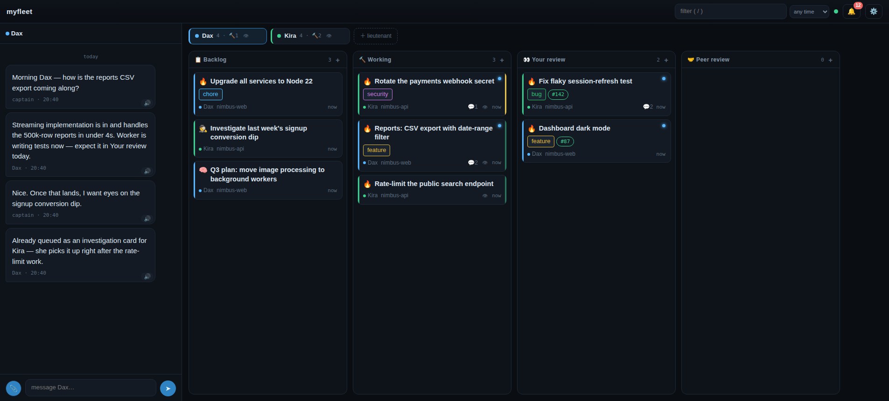

# Bridge Commander

<p align="center">
  <a href="https://youtu.be/lewm5_2LiNs">
    
  </a>
</p>

As you work with AI, your **attention gets fragmented** — driving multiple planning tasks while
overseeing multiple implementation tasks. Chat quickly becomes the wrong UX for piloting a fleet
of agents.

This skill lets you use Claude Code / Codex as multiple chiefs of staff (**lieutenants**). You
get a web UI where you work together, as work items get done by independent agent sessions on a
kanban board.



## Install

One skill:

```sh
npx skills add tonylampada/bridge-commander -g -y
```

That's it. The rest happens in the terminal you already have.

## Start

- Make an empty folder (e.g. `myfleet`) and start `claude` in it
- (Recommended) Set permissions mode to auto
- `/bridge-commander`
- Open the board URL it prints (default `http://localhost:4780/`)

**Bridget** is already there with a message waiting. She's your first lieutenant, and she does the
rest of the setup with you.

You need `tmux` and `git` on the machine (Bridget will offer to install if missing). 
You never have to use tmux yourself, but you can if you want.

## Configuration

Per-workspace config lives in `.bridge-commander/config.json`:

| Key | Default | Meaning |
|---|---|---|
| `port` | `4780` | server port (also `--port N` on `init`/`open`) |
| `host` | `127.0.0.1` | bind address — see network exposure below |
| `harness` | `claude` | default agent harness (`claude` \| `codex`) |
| `voices` | — | UI text-to-speech voice filter |
| `tts` | — | speak agent messages through an external TTS engine: `{"url": "http://127.0.0.1:8883", "lang": "pt", "voice": null, "params": {}}` (voxbench API). Absent = the board stays silent. The **server** reaches the engine: the browser talks to `/api/tts/*` on the board's own origin and the url only has to be reachable from the machine running the server (no CORS, no tailnet on the phone) |
| `stt` | — | dictation and call mode through an external STT engine: `{"url": "http://127.0.0.1:8878"}` (whisper_server API). Absent = no 🎤, no 📞. Proxied through `/api/stt/*` like `tts` |
| `publicUrl` | — | the board's https address, if it has one (e.g. `https://myboard.tail1234.ts.net`): a page opened over plain http names it where a secure context is needed (the call's microphone) |
| `push` | — | Web Push contact: `{"subject": "mailto:you@example.com"}` (the VAPID `sub` claim; must be `mailto:` or `https:`). Absent = the project URL. Push itself needs no config — see below |

Voice (TTS, dictation, call mode, push), end to end: [docs/voice.md](docs/voice.md).

Env knobs (set on the server process):

| Variable | Default | Meaning |
|---|---|---|
| `BC_SUPERVISE_INTERVAL_MS` | `30000` | supervision tick (lieutenant respawn, dead-worker detection); `0` disables |
| `BC_PRWATCH_INTERVAL_MS` | `120000` | PR watch tick; `0` disables |
| `BC_UPLOAD_MAX_BYTES` | `10485760` | per-file chat upload cap |
| `BC_WORKER_TTL_SECS` | `600` | card status lease TTL — `working`/`needs-you` decays to `idle` past it |
| `BC_WORKTREE_TOOL` | auto | `treehouse` \| `git` — worker worktree provisioning |
| `BC_HARNESS_STATE` | `~/.bridge-commander/harness` | harness state dir (prompts, session ids, turn-end logs) |
| `BC_GH_CMD` | `gh` | gh binary used by the PR watch and by the packaged `gh-watch` hook |
| `BC_SCHEDULE_INTERVAL_MS` | `15000` | schedule tick — how often the clock looks for due windows; `0` disables |
| `BC_TURNEND_URL` | — | default callback URL baked into installed turn-end hooks |
| `BC_SEND_RETRIES` / `BC_SEND_SLEEP_MS` | `3` / `400` | verified-submit tuning for `harness.send` |
| `BC_HOOK_TIMEOUT_MS` | `120000` | per-script timeout for workspace hooks, lifecycle and named alike |
| `BC_TEARDOWN_TIMEOUT_MS` | `300000` / `60000` | timeout for a playbook's `teardown` command — 5 min at the handoff and archive (un-awaited), 60s at a rework restart (awaited inside `card start`); set, it overrides both |
| `BC_TTS_IDLE_MS` | `20000` | how long the TTS passthrough waits for the next byte from the engine before hanging up — a gap between bytes, not a cap on the request |
| `BC_SYSLOAD_MS` | `2000` | monitoring panel (⚙️ → machine load) sample interval; the sampler runs only while the panel is open |

### Push notifications to a phone

⚙️ → **📲** turns on Web Push for that device: board events and lieutenant chat messages arrive
as system notifications with the board closed; a tap opens the board on the card. While it is on,
the notification rows grow a 📲 column next to the 🔊 one: each device picks which categories it
takes (default: card finished, chat, something went wrong — not "everything else"), kept
server-side per subscription. Needs a secure context (https, or `localhost`); on iPhone, open the
board from its home-screen icon first (Safari in a tab has no Web Push). The VAPID keypair and
device subscriptions live in `.bridge-commander/push/`, which git-ignores itself.

Behind an auth proxy (e.g. Cloudflare Access) delivery still works with an expired login — the
push service talks to the device directly — but turning push on/off, the **test** button and a
rotated subscription (`pushsubscriptionchange`) need a live login: reload the board, log in,
toggle again.

### Call mode

📞 in a lieutenant's chat header (shown when both `tts` and `stt` are configured) starts a
hands-free call. On a wide screen the call takes the chat pane only, the board stays usable beside it; a
phone gets the whole screen. The microphone needs https: a page opened over plain http says so,
naming `publicUrl` when config has one. The mic stays open. **His turn ends when he says the keyword** — "câmbio" by
default (a list works too, `keywords`); the STT is told to expect it (Whisper `hotwords`, sent as the
`hotwords` field; an `initial_prompt` via `sttPrompt` is off by default — in noise it makes Whisper
hallucinate the keyword over whole sentences — an engine that ignores them changes
nothing, one that rejects them gets the audio again without and the call stops sending them): a client VAD only cuts the audio into chunks, the whole turn is re-transcribed at each
chunk end (so a lone "câmbio" is heard in context), and the live transcript shows in the call
view until it ends with the keyword. The turn is cut at the last keyword (at the end, or followed by punctuation, so "o câmbio do
dólar" is just a word); the keyword and a dangling "o" / "e" / "então" before it are dropped, anything
said after it opens the next turn, and the rest is posted as a captain
message with `via: "call"` (drain shows **ON A CALL**; the thread shows 📞). A big **Send** button (bottom, under the thumb; disabled while
nothing is heard) ends the turn the same way when the keyword gets lost in the noise. Tapping the
transcript, or ending with "cancela", clears it. Every reply from that lieutenant is spoken back
sentence by sentence while the next sentence synthesizes. Talking over a reply ducks it at once
and stops it only when a quick STT finds words, so noise never kills playback. After 3s without
an answer a short pre-synthesized filler ("Let me check…") plays once. Everything the call
says or shows is English, like the replies; only his input is pt-BR. The screen stays on for the whole call (Screen Wake Lock, re-taken on every return; where
it is missing or refused — iOS before 18.4 in a home-screen app, Low Power Mode — a muted looping
1.7KB inline video primed in the 📞 tap; neither: a hint to set Auto-Lock), and the view dims after
30s untouched (the first tap only wakes it). A soft "plim" marks the turn going out, a lower tick a
"cancela". Under the avatar, and in every lieutenant's chat where the typing balloon lives, a live
line says what the lieutenant is doing ("🔧 running: gh pr checks 162", "📖 reading server.js",
"🤖 subagent working", elapsed time): the server tail-reads the session transcript the harness
already writes (`harness/activity.js`, polled 1s while a board is open, `BC_ACTIVITY_MS`; secrets in
commands redacted) — zero tokens from the lieutenant. On a call, a turn past 15s says it out loud
("Still running a command.", "Waiting on a subagent."), at most every 20s, only into silence, and
dropped the moment the reply lands. A hidden page or screen-off (proximity at
the ear) pauses the call and resumes it on return; past 60s away it ends, and says so. A change
of input device (AirPods in) re-takes the mic. Code: `ui/js/call.js` (audio + screen),
`ui/js/callcore.js` (decisions, tested in `test/call.test.js`).

Tuning per browser, no deploy: `localStorage['bc-call'] = '{"keywords":["câmbio"],"cancelWord":"cancela","debug":true}'`
— also `endMode: "silence"` (the old end-of-turn on trailing silence, off by default),
`sttHotwords` / `sttPrompt` (override the hints; `""` turns one off), `fillerMs`, `statusMs` / `statusGapMs` (spoken status, 15000 / 20000), and any key of `VAD_DEFAULTS` in `callcore.js` (`hangMs`, `maxUtteranceMs`,
`bargeMarginDb` / `bargeMinDb` / `bargeHoldMs`). `debug` logs state transitions and per-turn
latency to the console; `window.bcCallTurns` holds the last 50 turns.

### Lieutenant page actions

A lieutenant page (`lieutenants/<id>/page/`, served at `/lt/<id>/`) can change things when the
captain clicks on it. The board runs the lieutenant's own executable; the page calls it through
a small SDK. Try it at **`/lt/_demo/`** — the example in `examples/lt-page-actions/`.

**Write an action:** an executable file `lieutenants/<id>/actions/<name>` (any language, its own
shebang; name `[a-z0-9][a-z0-9._-]*`).

- It runs with cwd `lieutenants/<id>/`, spawned directly (no shell), and gets one JSON document
  on stdin: `{"action", "args", "lieutenant", "ts"}`.
- It prints one JSON document on stdout and exits 0: `{"ok": true, "result": …, "message"?: "…"}`,
  or `{"ok": false, "message": "…"}` to refuse (the captain sees the message as a toast; HTTP 422).
- A non-zero exit (500), stdout that is not that JSON (502) or more than 20 s (504, the process
  group is killed; `BC_LT_ACTION_TIMEOUT_MS` overrides) is a broken action, not a refusal: the
  answer carries the stderr tail.
- Actions write **data** (JSON in `page/data/` or `state/`) and the page renders from it. HTML
  an action edits is clobbered by the lieutenant's next page refresh.
- One action at a time per lieutenant, so read-modify-write on one file is safe.

**Call it from the page:**

```html
<script type="module">
  import * as bc from '/lt/_sdk/actions.js';
  const result = await bc.action('items', { op: 'add', text: 'x' });     // rejects + toasts on failure
  await bc.action('items', { op: 'delete', id }, { notify: true });      // also wakes the lieutenant
  bc.onChange(render);   // after any action on this lieutenant's page, from any tab
</script>
```

- `bc.action(name, args?, {notify?, quiet?})` resolves to the action's `result` and toasts its
  `message` if it gave one. A failure rejects with an `Error` whose message is the answer's
  `error`, with `.status` and `.body` on it, and toasts it with the stderr tail. `quiet: true`
  skips both toasts, for a page that shows the outcome itself.
- `bc.onChange(cb)` returns an unsubscribe function. `cb` gets `{id, action, local: true, result}`
  after this tab's own action and the `lt-page-changed` payload after another tab's. Without a
  handler the page reloads after an action.
- Also exported: `bc.toast(text, 'error'?)` and `bc.lieutenant` (the id from the URL).

**The HTTP contract**, for a page that calls the route itself.
`POST /lt/<id>/action/<name>` with `Content-Type: application/json` and `{args, notify, client}`:

- `args`: any JSON, handed to the action as is; `{}` when absent. `notify`: only `true` notifies.
- `client`: the sending tab's tag, a random 8-character string the SDK picks once per page load.
  The board neither checks nor logs it: it echoes the first 64 characters as `by` on
  `lt-page-changed`, and the SDK ignores an event whose `by` is its own, because that tab already
  re-rendered when its POST answered. Without it, `by` is `""` and every tab re-renders.

Every answer has `ok`; every failure has `error`, so read that for the reason.

| Status | Body | When |
|---|---|---|
| 200 | `{ok: true, result, message?}` | it worked; `result` is `null` when the action printed none |
| 422 | `{ok: false, error, message?}` | the action refused: `error` is its `message`, or `action <name> refused` when it gave none; `message` is its own text, absent when it gave none |
| 500, 502, 504 | `{ok: false, error, stderr?}` | the action broke (exit or spawn failure, bad stdout, timeout): `error` says which, `stderr` is its last 4096 characters when there was any |
| 404 | `{ok: false, error}` | unknown lieutenant, or no such action: a bad name, a missing or non-executable file and a symlink out of `actions/` all look the same |
| 415, 400 | `{ok: false, error}` | no `Content-Type: application/json`; body not a JSON object |

After a successful action every open page hears `lt-page-changed {id, action, by, updated}` on
`/api/events`; `updated` is the page's newest-file stamp (ISO), `null` on `/lt/_demo/`.

**What the lieutenant hears:** every run, ok or not, is one JSON line in
`lieutenants/<id>/state/actions.jsonl`:

- `ts` (ISO, the same one the action got on stdin), `action`, `args`, `ok`, `notify`,
- `ms`: the run's wall time in milliseconds, spawn to exit,
- `result` when ok, `error` when not (the same string the page got), and `message` when the
  action gave one.

A page comment is logged too, as `{ts, action: "comment", args: {page, quote, comment}, ok: true,
notify: true}` with no `ms`.

`notify: true` also queues a `page-action` item that wakes the lieutenant, carrying `ok`, the HTTP
`status`, `refused` (true on a 422), `message`, and `args` and `result` (each clipped to 1500
characters) or the refusal or `error`. Drain reads a refusal as "your action refused it:
<message>" (his input was rejected; nothing is broken) and only a 5xx as "IT FAILED". `notify:
false` waits in the log for its next turn.

The log holds action args and comment text verbatim. When those can be personal, git-ignore it
in the workspace (`lieutenants/*/state/actions.jsonl` in its `.gitignore`), since a lieutenant
commits its folder on every page refresh.

**Comment on selection** comes free on every page: the board adds `/lt/_sdk/comment.js` to each
HTML file it serves (the file on disk is untouched). Select text → 💬 Comentar → the comment
lands in the lieutenant's main chat as a captain message, quoting the selection and naming the
page. A page copied elsewhere (here.now, Armada) carries no overlay and no action endpoint —
actions exist only on the board.

Its route is `POST /lt/<id>/comment` `{quote, comment, page}`, `Content-Type: application/json`
only. `comment` is cut at 4000 characters and `quote` at 2000; a `page` that is not a path under
`/lt/<id>/` becomes `/lt/<id>/`. It answers `{ok: true, seq, to}` (the queue item's number and
the lieutenant it reached); 400 for an empty comment or a body that is not a JSON object, 409
when the board has no lieutenant to receive it.

### Network exposure

The board has **no application-level auth** — whoever reaches the bind address fully controls
the board, including starting workers (running code):

- **Default (recommended): loopback only** (`127.0.0.1`).
- Private mesh (e.g. Tailscale): set `host` to that interface's address; a loopback listener is
  kept alongside. The mesh is your only auth boundary.
- **Never bind `0.0.0.0`.**

How it works inside: [ARCHITECTURE.md](ARCHITECTURE.md). The conceptual API
([docs/api/overview.md](docs/api/overview.md)) is the spec the implementation follows.
