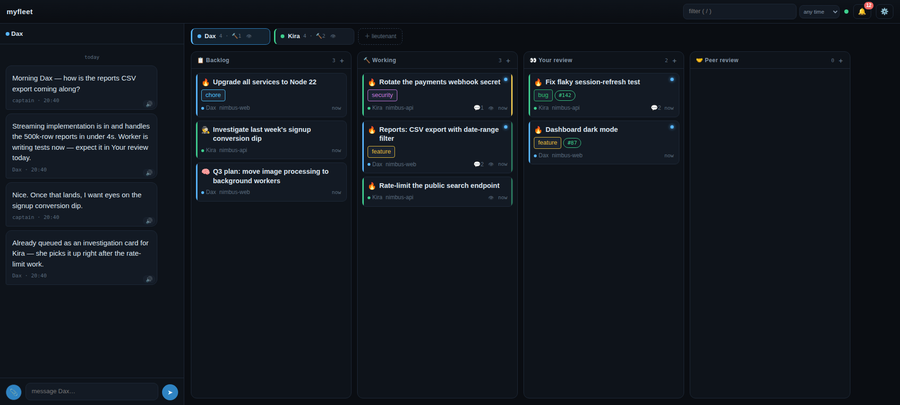

# Bridge Commander

<p align="center">
  <a href="https://youtu.be/lewm5_2LiNs">
    
  </a>
</p>

As you work with AI, your **attention gets fragmented** — driving multiple planning tasks while
overseeing multiple implementation tasks. Chat quickly becomes the wrong UX for piloting a fleet
of agents.

This skill lets you use Claude Code / Codex as multiple chiefs of staff (**lieutenants**). You
get a web UI where you work together, as work items get done by independent agent sessions on a
kanban board.



## Install

One skill:

```sh
npx skills add tonylampada/bridge-commander -g -y
```

That's it. The rest happens in the terminal you already have.

## Start

- Make an empty folder (e.g. `myfleet`) and start `claude` in it
- (Recommended) Set permissions mode to auto
- `/bridge-commander`
- Open the board URL it prints (default `http://localhost:4780/`)

**Bridget** is already there with a message waiting. She's your first lieutenant, and she does the
rest of the setup with you.

You need `tmux` and `git` on the machine (Bridget will offer to install if missing). 
You never have to use tmux yourself, but you can if you want.

## Configuration

Per-workspace config lives in `.bridge-commander/config.json`:

| Key | Default | Meaning |
|---|---|---|
| `port` | `4780` | server port (also `--port N` on `init`/`open`) |
| `host` | `127.0.0.1` | bind address — see network exposure below |
| `harness` | `claude` | default agent harness (`claude` \| `codex`) |
| `voices` | — | UI text-to-speech voice filter |
| `tts` | — | speak agent messages through an external TTS engine: `{"url": "http://127.0.0.1:8883", "lang": "pt", "voice": null, "params": {}}` (voxbench API). Absent = the board stays silent. The **server** reaches the engine: the browser talks to `/api/tts/*` on the board's own origin and the url only has to be reachable from the machine running the server (no CORS, no tailnet on the phone) |
| `push` | — | Web Push contact: `{"subject": "mailto:you@example.com"}` (the VAPID `sub` claim; must be `mailto:` or `https:`). Absent = the project URL. Push itself needs no config — see below |

Env knobs (set on the server process):

| Variable | Default | Meaning |
|---|---|---|
| `BC_SUPERVISE_INTERVAL_MS` | `30000` | supervision tick (lieutenant respawn, dead-worker detection); `0` disables |
| `BC_PRWATCH_INTERVAL_MS` | `120000` | PR watch tick; `0` disables |
| `BC_UPLOAD_MAX_BYTES` | `10485760` | per-file chat upload cap |
| `BC_WORKER_TTL_SECS` | `600` | card status lease TTL — `working`/`needs-you` decays to `idle` past it |
| `BC_WORKTREE_TOOL` | auto | `treehouse` \| `git` — worker worktree provisioning |
| `BC_HARNESS_STATE` | `~/.bridge-commander/harness` | harness state dir (prompts, session ids, turn-end logs) |
| `BC_GH_CMD` | `gh` | gh binary used by the PR watch and by the packaged `gh-watch` hook |
| `BC_SCHEDULE_INTERVAL_MS` | `15000` | schedule tick — how often the clock looks for due windows; `0` disables |
| `BC_TURNEND_URL` | — | default callback URL baked into installed turn-end hooks |
| `BC_SEND_RETRIES` / `BC_SEND_SLEEP_MS` | `3` / `400` | verified-submit tuning for `harness.send` |
| `BC_HOOK_TIMEOUT_MS` | `120000` | per-script timeout for workspace hooks, lifecycle and named alike |
| `BC_TEARDOWN_TIMEOUT_MS` | `300000` / `60000` | timeout for a playbook's `teardown` command — 5 min at the handoff and archive (un-awaited), 60s at a rework restart (awaited inside `card start`); set, it overrides both |
| `BC_TTS_IDLE_MS` | `20000` | how long the TTS passthrough waits for the next byte from the engine before hanging up — a gap between bytes, not a cap on the request |
| `BC_SYSLOAD_MS` | `2000` | monitoring panel (⚙️ → machine load) sample interval; the sampler runs only while the panel is open |

### Push notifications to a phone

⚙️ → **📲** turns on Web Push for that device: board events and lieutenant chat messages arrive
as system notifications with the board closed; a tap opens the board on the card. While it is on,
the notification rows grow a 📲 column next to the 🔊 one: each device picks which categories it
takes (default: card finished, chat, something went wrong — not "everything else"), kept
server-side per subscription. Needs a secure context (https, or `localhost`); on iPhone, open the
board from its home-screen icon first (Safari in a tab has no Web Push). The VAPID keypair and
device subscriptions live in `.bridge-commander/push/`, which git-ignores itself.

Behind an auth proxy (e.g. Cloudflare Access) delivery still works with an expired login — the
push service talks to the device directly — but turning push on/off, the **test** button and a
rotated subscription (`pushsubscriptionchange`) need a live login: reload the board, log in,
toggle again.

### Call mode

📞 in a lieutenant's chat header (shown when both `tts` and `stt` are configured) starts a
hands-free call. The mic stays open. **His turn ends when he says the keyword** — "câmbio" by
default (a list works too, `keywords`); the STT is told to expect it (Whisper `hotwords`, sent as the
`hotwords` field; an `initial_prompt` via `sttPrompt` is off by default — in noise it makes Whisper
hallucinate the keyword over whole sentences — an engine that ignores them changes
nothing, one that rejects them gets the audio again without and the call stops sending them): a client VAD only cuts the audio into chunks, the whole turn is re-transcribed at each
chunk end (so a lone "câmbio" is heard in context), and the live transcript shows in the call
view until it ends with the keyword. The turn is cut at the last keyword (at the end, or followed by punctuation, so "o câmbio do
dólar" is just a word); the keyword and a dangling "o" / "e" / "então" before it are dropped, anything
said after it opens the next turn, and the rest is posted as a captain
message with `via: "call"` (drain shows **ON A CALL**; the thread shows 📞). A big **Send** button (bottom, under the thumb; disabled while
nothing is heard) ends the turn the same way when the keyword gets lost in the noise. Tapping the
transcript, or ending with "cancela", clears it. Every reply from that lieutenant is spoken back
sentence by sentence while the next sentence synthesizes. Talking over a reply ducks it at once
and stops it only when a quick STT finds words, so noise never kills playback. After 3s without
an answer a short pre-synthesized filler ("Let me check…") plays once. Everything the call
says or shows is English, like the replies; only his input is pt-BR. The screen stays on for the whole call (Screen Wake Lock, re-taken on every return; where
it is missing or refused — iOS before 18.4 in a home-screen app, Low Power Mode — a muted looping
1.7KB inline video primed in the 📞 tap; neither: a hint to set Auto-Lock), and the view dims after
30s untouched (the first tap only wakes it). A soft "plim" marks the turn going out, a lower tick a
"cancela". Under the avatar, and in every lieutenant's chat where the typing balloon lives, a live
line says what the lieutenant is doing ("🔧 running: gh pr checks 162", "📖 reading server.js",
"🤖 subagent working", elapsed time): the server tail-reads the session transcript the harness
already writes (`harness/activity.js`, polled 1s while a board is open, `BC_ACTIVITY_MS`; secrets in
commands redacted) — zero tokens from the lieutenant. On a call, a turn past 15s says it out loud
("Still running a command.", "Waiting on a subagent."), at most every 20s, only into silence, and
dropped the moment the reply lands. A hidden page or screen-off (proximity at
the ear) pauses the call and resumes it on return; past 60s away it ends, and says so. A change
of input device (AirPods in) re-takes the mic. Code: `ui/js/call.js` (audio + screen),
`ui/js/callcore.js` (decisions, tested in `test/call.test.js`).

Tuning per browser, no deploy: `localStorage['bc-call'] = '{"keywords":["câmbio"],"cancelWord":"cancela","debug":true}'`
— also `endMode: "silence"` (the old end-of-turn on trailing silence, off by default),
`sttHotwords` / `sttPrompt` (override the hints; `""` turns one off), `fillerMs`, `statusMs` / `statusGapMs` (spoken status, 15000 / 20000), and any key of `VAD_DEFAULTS` in `callcore.js` (`hangMs`, `maxUtteranceMs`,
`bargeMarginDb` / `bargeMinDb` / `bargeHoldMs`). `debug` logs state transitions and per-turn
latency to the console; `window.bcCallTurns` holds the last 50 turns.

### Network exposure

The board has **no application-level auth** — whoever reaches the bind address fully controls
the board, including starting workers (running code):

- **Default (recommended): loopback only** (`127.0.0.1`).
- Private mesh (e.g. Tailscale): set `host` to that interface's address; a loopback listener is
  kept alongside. The mesh is your only auth boundary.
- **Never bind `0.0.0.0`.**

How it works inside: [ARCHITECTURE.md](ARCHITECTURE.md). The conceptual API
([docs/api/overview.md](docs/api/overview.md)) is the spec the implementation follows.
